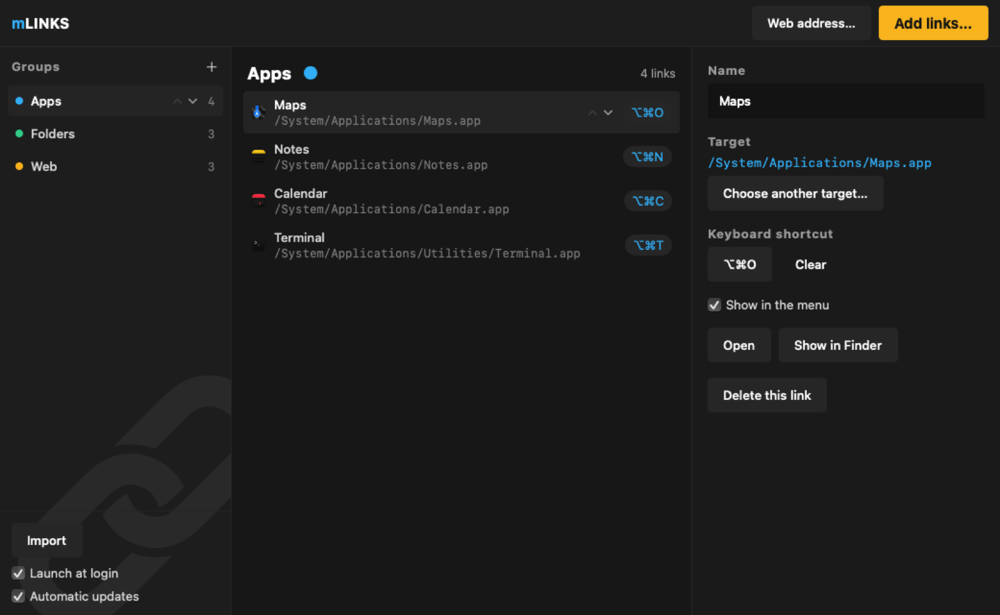

<p align="center"></p>

# mLINKS

[](https://openmacapps.com/apps/mlinks/) [](https://github.com/starbudweiser/mLINKS/releases/latest) [](LICENSE)

Your apps, folders, files and web addresses one click away, from the macOS menu bar or with a global keyboard shortcut.

🇬🇧 English · 🇫🇷 [Français](#français)

## About

mLINKS is a personal, from-scratch re-creation of the idea behind [QuickLinks](https://appyogi.com/webapps/index.php?product_id=40&source=com.appyogi.quicklinks&ref=about) by Appyogi. It is not affiliated with Appyogi and shares none of its code or assets.

mLINKS is part of the **DESKTOP MAC TOOLKIT**, Starbudweiser's collection of macOS apps.

Authors: Starbudweiser & Claude Code (Anthropic). MIT License, © 2026 Starbudweiser. Provided as is, without warranty.



## Features

- **Menu bar menu**: your groups as submenus, with icons. Hold ⌥ to reveal an item in Finder instead of opening it.
- **Links to anything**: apps, folders, files and web addresses. A missing target (unplugged disk) is flagged "Not found"; a sleeping external disk never freezes the menu.
- **Global shortcuts**: one per link, no Accessibility permission needed.
- **Add from anywhere (Services menu)**: right-click a volume, a folder, an app or a file in Finder, or an address selected in the address bar of any browser, then open the **Services** submenu at the very bottom of the right-click menu and choose **Add to mLINKS**. With several groups, a small picker next to the pointer asks where to place the link; with one, it goes straight in. A short message confirms it, and a link already in the group is not added twice. See [Add from anywhere](#add-from-anywhere-services-menu) below.
- **Manager window**: create, rename and reorder groups, drag and drop from Finder, hide links from the menu.
- **Import from QuickLinks**: reads the QuickLinks (Appyogi) database or a `.CSV` export, never modifies them, and never creates duplicates when re-imported. Offered on the welcome screen of an empty library, or with `mLINKS --import file`.
- **Automatic updates**: checks GitHub releases once a day (can be turned off), verifies the Developer ID signature and notarization, then replaces and relaunches the app from the menu.
- **Four languages** (French, English, Spanish, Italian), picked from the system language.
- Dark, flat interface; no Dock icon; optional launch at login.

## Install

**[Download the latest notarized release](https://github.com/starbudweiser/mLINKS/releases/latest)**, unzip it and move **mLINKS.app** to your Applications folder. Requires **macOS 14 Sonoma** or later.

## Add from anywhere (Services menu)

"Add to mLINKS" lives in the **Services** submenu, the last entry of the right-click menu (it is not a top-level item). It works on:

- a **volume**, a **folder**, an **app** or a **file** selected in Finder;
- an **address selected as text**, for example in a browser's address bar (a missing `https://` is added).

macOS only shows a service once it is allowed. If **Add to mLINKS** is not in the Services submenu, enable it:

1. Open **System Settings › Keyboard › Keyboard Shortcuts… › Services**.
2. Tick **Add to mLINKS** under **Files and Folders** (for Finder) and under **Text** (for selected addresses).

If it still does not show after enabling it, quit and relaunch mLINKS once.

## Build

Requires macOS 14+ and Xcode (Swift 6).

```bash
swift test          # unit tests
./build_app.sh      # builds mLINKS.app, signs it and installs it
```

`NO_INSTALL=1 ./build_app.sh` builds `./mLINKS.app` without installing it. Without a local signing identity, the app is signed ad hoc. Links are stored in `~/Library/Application Support/mLINKS/links.json`.

Offscreen checks, without opening any window: `mLINKS --capture out.png`, `--capture-about out.png`, `--capture-chooser out.png`, `--import file`.

## Languages

English, French, Spanish and Italian. The app follows your Mac's preferred language automatically (English if it is none of these four).

## Support

Bug reports and suggestions: [GitHub Issues](https://github.com/starbudweiser/mLINKS/issues).

## License

Released under the **MIT License**, © 2026 Starbudweiser. See [LICENSE](LICENSE).

---

## Français

Vos applis, dossiers, fichiers et adresses web à un clic, depuis la barre de menus de macOS ou avec un raccourci clavier global.

La documentation complète en français est dans **[README.fr.md](README.fr.md)**.

Installation : téléchargez la [dernière version notarisée](https://github.com/starbudweiser/mLINKS/releases/latest), décompressez-la et placez **mLINKS.app** dans Applications (macOS 14 Sonoma ou plus récent).

Interface en français, anglais, espagnol et italien, choisie d'après la langue du Mac (anglais sinon). Licence MIT, © 2026 Starbudweiser. Questions et bugs : [Issues GitHub](https://github.com/starbudweiser/mLINKS/issues).

## Support / Soutenir

This app is free. If it is useful to you, you can support the project (optional, no reward expected): [GitHub Sponsors](https://github.com/sponsors/starbudweiser).

Cette appli est gratuite. Si elle vous est utile, vous pouvez soutenir le projet (facultatif, sans contrepartie) : [GitHub Sponsors](https://github.com/sponsors/starbudweiser).
